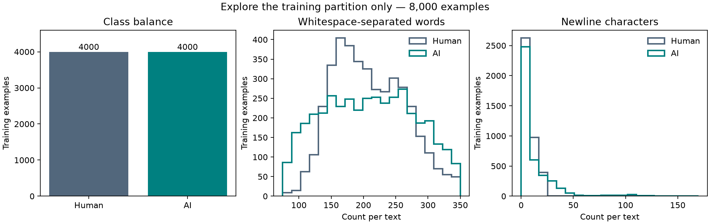
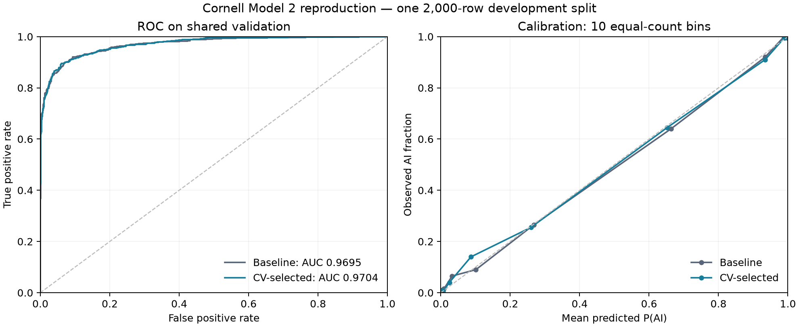

# Model 2 reproduction results

Report finalized at 2026-11-08T17:24:54.952451+00:00. Model execution times are preserved separately in each execution.json; do not infer them from the report or commit date.

| Configuration | Fresh validation AUROC | Excluding 12 high-similarity IDs | False positives / false negatives at 0.5 |
|---|---:|---:|---:|
| Baseline character 3–5, C=1 | 0.969466 | 0.969095 | 70 / 102 |
| Selected character 2–4, C=1 | 0.970440 | 0.970081 | 68 / 103 |

Both AUROCs match inherited results. The difference is 0.000974 and is not established as statistically reliable. Both use the same reused canonical development split; this is reproduction, not an independent generalization test. The original eight-configuration selection was not rerun. Core model source and configurations are unchanged.

Data checks confirmed all five CSV hashes and the original ZIP hash, 8,000/2,000 balanced partition membership, no normalized exact overlap across the split, 12 validation IDs with hashed word-trigram cosine >=0.9, and 386 starter IDs in validation. Sensitivity removes the 12 IDs only from scoring; models and split are unchanged.

The full-data model fit all 10,000 labeled rows. Its local `artifacts/run-001/full-data/submission.csv` has 3,000 unique IDs in test order, exact columns id,label, and finite probabilities in [0,1]. SHA256: `6b8b053afd64c5c41c0c1b5de9d94f21958f405352aefe828738d9af9c437937`. No upload or test AUROC is claimed.

The initial isolated environment and a second fresh install both passed 15 tests; pip dependency checks and the model2 command entry point passed. New acquisition tests cover hash rejection, no overwrite, and unsafe archive paths. Full workflow runs, diagnostics, plotting, and verification completed successfully. Python 3.11.5, numpy 2.4.6, pandas 3.1.1, scipy 1.17.1, scikit-learn 1.9.1; exact installed versions are locked in requirements-lock.txt.

## Reviewed exploration and diagnostics

Both classes have 4,000 training examples. Word counts overlap substantially (medians 204 human, 209 AI). Newline medians differ (2 human, 6 AI), but formatting, genre, or source composition could explain this; no authorship rule is established. Codex inspected all six seeded training examples and verified membership. User interpretation remains pending. No labels or features changed.

Selected validation AUROC ranges from 0.92767 for fewer than 100 words to 0.98832 for at least 300 words. The shortest slice has only six human examples and should be interpreted cautiously. Confident mistakes occur in both conversational and reference-like prose. Error excerpts were reviewed, not used to relabel or tune. See records/reproductions/run-001/error_analysis.md and the aggregate diagnostics.

## Readiness and remaining work

The local Model 2 computation and prediction deliverables are complete. Strict Milestone A acceptance remains incomplete only for authenticated end-to-end Kaggle API acquisition: the client and download script work locally, but the API responds that authentication is required. This run deliberately reused the already downloaded, byte-verified archive. No credential was requested in chat. User exploration review is separately marked pending.

Source attribution and AI disclosure are in PROVENANCE.md. Private instructions, raw data, example exports, and predictions are excluded from Git. New runs have UTC timestamps, command, environment, Git state, and source/input hashes. Runs preceded the first local commit, so their null git_commit fields are retained honestly.

Milestone B is not complete: it still needs Models 1/3 results, the official report template/requirements, team model selection, and separately authorized remote publication and Kaggle submission. No remote repository, push, PR, or upload was performed during the reproduction run. Subsequent GitHub publication is a separate user-authorized action; no Kaggle submission is implied.
