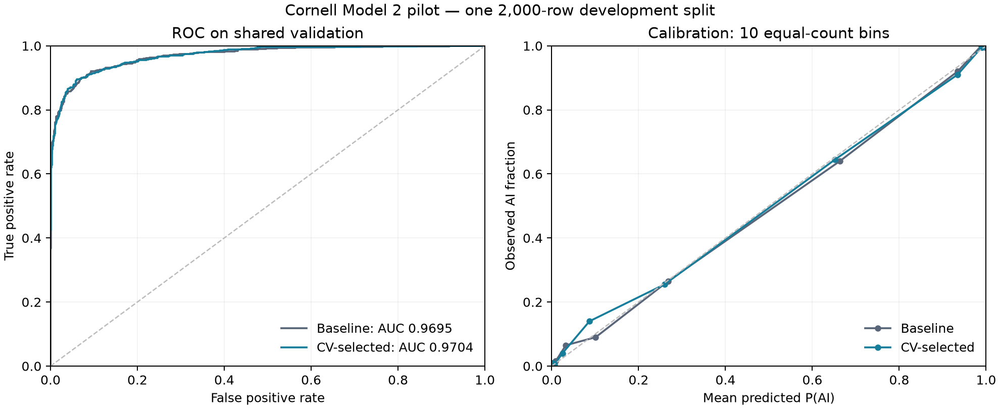

# Cornell Model 2 experiments

Completed November 7, 2026. These results use the official Cornell dataset and are separate from the [DAIGT rehearsal](../rehearsal/README.md). No test predictions have been submitted and no public/private Kaggle score is available.

## Data preparation and audit

The competition ZIP passed its CRC check and was preserved under ignored `data/raw/archives/`. Five CSVs were extracted to `data/raw/` without changing their bytes. [Data provenance](data_manifest.json) records archive and per-file SHA-256 hashes. macOS resource files were not extracted.

| File | Rows | Labels |
|---|---:|---|
| train.csv | 10,000 | 5,000 human; 5,000 AI |
| train_starter_2000.csv | 2,000 | 1,000 human; 1,000 AI; exact subset of train.csv |
| unlabeled.csv | 3,000 | Not supplied |
| test.csv | 3,000 | Not supplied |
| sample_submission.csv | 3,000 | IDs match test.csv |

There are no blank texts, duplicate IDs, normalized duplicate texts, or conflicting normalized labels within the inspected input files. Train, unlabeled and test have no intersecting IDs or normalized texts. Normalization for auditing uses Unicode NFKC, casefold and collapsed whitespace; the classifier receives original text with its configured preprocessing. See [audit](audit.json).

Training text lengths span 75–350 words (median 206); unlabeled median is 206.5 and test median is 213. Training-partition human/AI mean lengths are similar (209.33/208.72 words). AI-labeled training texts have more newlines on average (12.21 vs 5.80); this is a descriptive pattern, not an authorship rule or a reason to remove formatting. No feature was added or removed based on these observations. See [training-only text summaries](training_text_summary.csv).

## Training and validation split

The canonical split uses original CSV row order, stratified 80/20 sampling, and seed 42: 8,000 training examples (4,000 per class) and 2,000 validation examples (1,000 per class). All model comparisons must use the same validation IDs.

The ID-only [split.csv](shared_split/split.csv) and [protocol](shared_split/README.md) define the partition. A local convenience archive is stored at `artifacts/cornell/team_split_v1.zip`. The split hash is `15340e28ee050a0023b017abeddd2d3b72b7fc05612b9d299b59d88d31a1cb2b`.

The supplied starter includes **386 shared-validation IDs**. Do not use it directly as a training-only subset. Construct smaller training or learning-curve subsets from the training IDs instead.

An approximate nearest-training audit using hashed word-trigram cosine flags **12 validation passages at similarity >=0.9**, all AI-labeled with AI-labeled nearest neighbors. There are no exact normalized duplicates. This diagnostic is not a complete semantic duplicate detector. The shared split was retained for compatibility, and a sensitivity analysis excludes the flagged rows from scoring. Inner CV and calibration were not grouped by near-duplicate/source families; their scores may also benefit from overlap. Source/generator labels are not provided in the CSVs, so unseen-domain/generator performance has not been measured.

## Experiment design and results

The experiment plan was written before tuning: six analyzer/ngram combinations at C=1, followed by C=0.1 and C=10 for the representation with the highest internal-CV AUROC. Each trial used the same three stratified folds inside the 8,000 training rows. TF-IDF was refitted within each fold. Validation labels were not supplied to model selection. This is a staged search of eight configurations (24 fold fits), not an exhaustive 18-configuration grid.

| Analyzer | N-grams | C | Mean internal-CV AUROC |
|---|---|---:|---:|
| char | 2–4 | 1 | **0.969203** |
| char | 3–5 | 1 | 0.965472 |
| char | 3–6 | 1 | 0.964840 |
| char_wb | 2–4 | 1 | 0.932721 |
| char_wb | 3–5 | 1 | 0.925255 |
| char_wb | 3–6 | 1 | 0.924939 |
| char | 2–4 | 0.1 | 0.961689 |
| char | 2–4 | 10 | 0.966988 |

All configurations retain min_df=2, at most 100,000 features, lowercase and sublinear TF. The selected candidate is [cornell_selected.json](../../configs/cornell_selected.json). The original baseline configuration is preserved. See [selection and fold results](pilot-001/selection.json).

Both baseline and selected candidate were fitted on the full 8,000 training rows, including three-fold sigmoid calibration of the entire TF-IDF/SVM pipeline. The calibrator never used outer-validation labels. With this calibration setup, the observed probability and raw-margin AUROCs are identical.

| Validation measure | Baseline char 3–5, C=1 | Selected char 2–4, C=1 |
|---|---:|---:|
| AUROC | 0.969466 | **0.970440** |
| Brier score | 0.065473 | 0.065252 |
| Log loss | 0.219593 | 0.217227 |
| False positives at 0.5 | 70 | 68 |
| False negatives at 0.5 | 102 | 103 |
| AUROC after excluding 12 high-similarity cases | 0.969095 | 0.970081 |

The validation AUROC gain is 0.000974. It is small and has not been established as statistically reliable. Training AUROC is approximately 1.0 for both models, indicating a substantial train/validation gap. These are development scores from one split/seed, not unbiased estimates after repeated future selection, and not Kaggle test performance. The comparison does not prove why `char` outperformed `char_wb`; punctuation and cross-word patterns are possible explanations requiring controlled ablations.



The calibration plot uses ten equal-count bins, with no uncertainty intervals. It describes this validation sample only.

## Length and error analysis

| Selected-model word-count bin | Rows | Human / AI | AUROC |
|---|---:|---:|---:|
| <100 | 59 | 6 / 53 | 0.927673 |
| 100–199 | 887 | 476 / 411 | 0.959946 |
| 200–299 | 883 | 454 / 429 | 0.979006 |
| >=300 | 171 | 64 / 107 | 0.988318 |

Shorter texts perform worse in this sample, but length is entangled with topic/style and the shortest bin contains only six human examples. Do not infer that increasing passage length would cause the same improvement. [Detailed slice metrics](pilot-001/selected_length_slices.csv) include class-specific error rates.

Five highest-confidence FP and five highest-confidence FN were selected for local review. These are deliberately extreme cases, not a representative random sample. Reviewed excerpts show:

- Human false positives include a keyboard troubleshooting post, a fiction-writing discussion, a technical encyclopedia-style explanation, a personal reflection, and a biographical passage. Formal prose alone does not explain all errors.
- AI false negatives include forum-like discussion, a technical question, recipes, and an encyclopedia-like biography. These styles overlap with human writing; apparent genre is not ground-truth provenance.
- No label was changed based on these impressions. The causes of these individual predictions have not been established by feature attribution or intervention.

Full texts remain in ignored `artifacts/cornell/selected-diagnostics-001/error_cases_local_only.csv`. The two models' aligned validation predictions are under `artifacts/cornell/{baseline,selected}-001/validation_predictions.csv`. Cross-model comparisons require joining predictions by ID. Raw texts and bulk predictions are excluded from Git.

## Reproduce

Use the project environment (actual recorded runtime: Python 3.11.16, scikit-learn 1.9.0, pandas 3.0.5, NumPy 2.4.6, SciPy 1.17.1). Commands below assume repository root, exact original CSVs, and new output directories. Existing `-001` directories are preserved; increment suffixes for reruns.

```bash
PYTHONPATH=src python -m model2.cornell audit --out artifacts/cornell/audit-002
PYTHONPATH=src python -m model2.cli evaluate --out artifacts/cornell/baseline-002
PYTHONPATH=src python -m model2.cornell tune --out artifacts/cornell/search-002
PYTHONPATH=src python -m model2.cli evaluate --config artifacts/cornell/search-002/selected_config.json --out artifacts/cornell/selected-002
PYTHONPATH=src python -m model2.cornell diagnose --predictions artifacts/cornell/selected-002/validation_predictions.csv --out artifacts/cornell/selected-diagnostics-002
```

The CLI default split path is `artifacts/shared-split/split.csv`. On a new clone, create its parent directory and copy the tracked `records/cornell/shared_split/split.csv` there, or pass that tracked path with `--split` to audit/tune/evaluate. Do not regenerate membership independently. Optional plots require the `plots` dependency extra:

```bash
python scripts/plot_cornell.py --baseline artifacts/cornell/baseline-001/validation_predictions.csv --selected artifacts/cornell/selected-001/validation_predictions.csv --out artifacts/cornell/diagnostics-copy.png
```

Manifests retain the actual commands, environment, hashes and Git state. Search trials are written after each completion; `selection.json` indicates the staged search finished. The run used uncommitted changes over `7ad4493`; code hashes identify the search implementation. The original source ZIP and all CSVs remain local and ignored. No external rehearsal texts were used in Cornell fitting.

## Validation and remaining work

Thirteen tests passed, including a training/validation separation test for the search runner and true-label alignment validation for diagnostics. Archive/file integrity, source schemas, sample-submission IDs, split counts, and all completed experiment outputs were checked. The generated plot was visually inspected. Plot generation succeeded with local font-cache warnings; no model fitting failed. Clean-environment installation remains untested.

Remaining work includes group-aware robustness evaluation, cross-model comparisons using aligned predictions, independent review of the interpretation, and completion of the course report and required PR. Learning curves, unlabeled-data experiments, and stylometric improvements are outside the completed Model 2 experiment. The selected configuration has been refitted on all labeled data and its 3,000 test probabilities generated (see below). Final cross-model selection and Kaggle upload remain pending; the official report template is not yet available.

OpenAI Codex assisted with the pipeline implementation, executed the recorded runs, and drafted the analysis. Independent review and final cross-model conclusions remain pending.

## Full-data run — November 7, 2026

The selected character 2–4/C=1 configuration was fitted on all 10,000 labeled rows. Three-fold out-of-fold margins fit the sigmoid calibrator; the final TF-IDF/SVM pipeline was refitted on all supplied training rows (`ensemble=False`). Unlabeled and test texts were not used for fitting.

The run completed in 28.51 seconds and produced `artifacts/cornell/full-data-001/submission.csv`. Local validation confirmed exactly 3,000 unique IDs in test-row order, sample-submission ID compatibility, columns `id,label`, and finite class-1 probabilities in [0,1]. Input and configuration hashes matched. See [run manifest](full-data-001/manifest.json) and [output validation and source hashes](full-data-001/validation.json).

```bash
PYTHONPATH=src python -m model2.cli submit --config configs/cornell_selected.json --out artifacts/cornell/full-data-002
```

Use the existing environment or an equivalent environment with the recorded versions; increment the output suffix for a new run. The CSV remains ignored locally. No binary model was saved. No Kaggle upload has occurred, and no test AUROC can be computed without hidden labels. The earlier 0.970440 AUROC belongs to the 8,000-row development fit, not this full-data model. Cross-model comparison and final submission choice remain separate from generating this Model 2 candidate.
